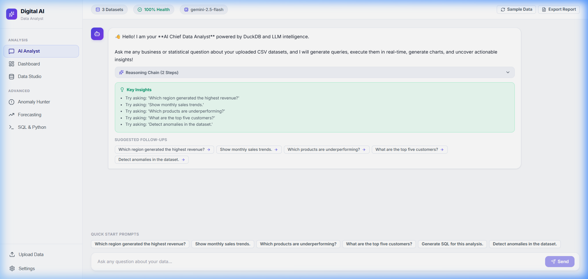
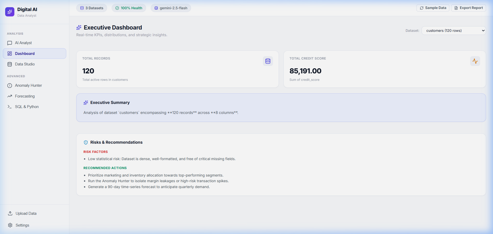
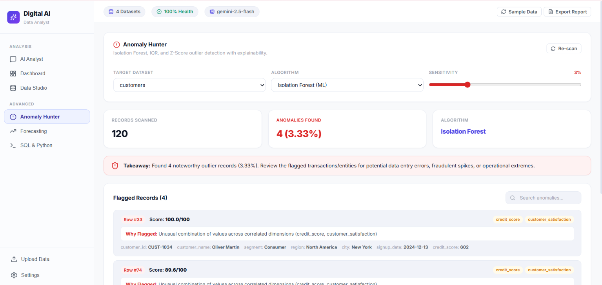
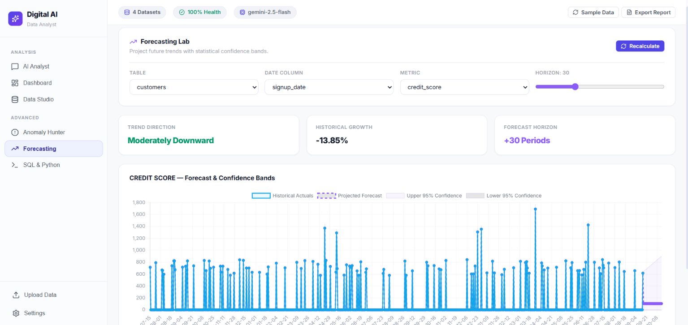
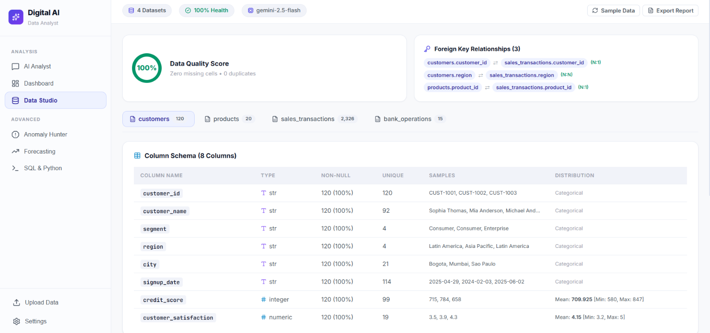
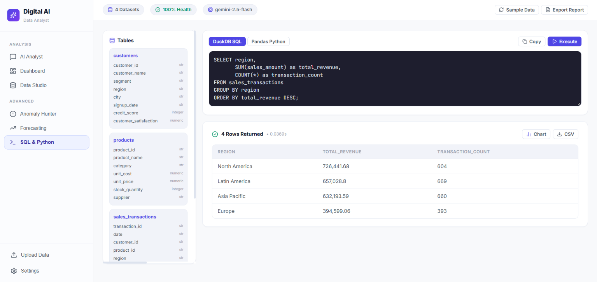
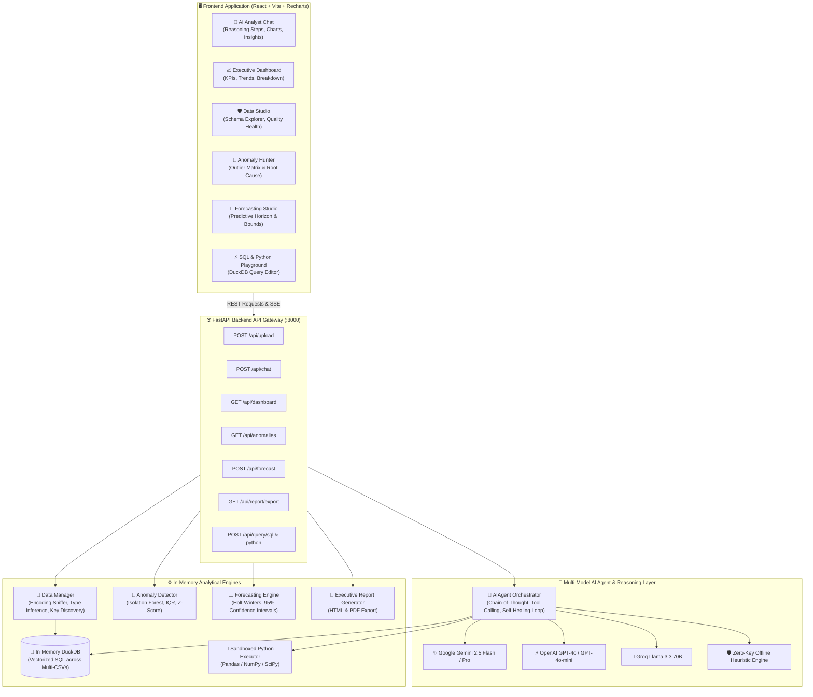

# 📊 Digital AI Data Analyst — Production-Ready Enterprise Platform

An end-to-end, production-grade AI Data Analyst enabling users to upload single or multiple CSV files, interact using natural language, generate automated executive dashboards, visualize data with dynamic charts, detect statistical anomalies with root-cause explanations, and run predictive time-series forecasting.

---

## 🔗 Live Demo & Video Walkthrough

- **🌐 Live Application URL:** [https://digital-ai-analyst.vercel.app/](https://digital-ai-analyst.vercel.app/)
- **🎥 Loom Video Walkthrough:** [Watch 2.5-Minute Video Walkthrough](https://www.loom.com/share/31db003140df4ada9de06619cfbd66d0)

---

## 📸 Application Screenshots

| 💬 AI Analyst & Reasoning Interface | 📈 Instant Executive Dashboard |
| :---: | :---: |
|  |  |

| 🚨 Anomaly Hunter (Root-Cause Explanations) | 🔮 Time-Series Forecasting Studio |
| :---: | :---: |
|  |  |

| 🛡️ Data Studio & Schema Quality | ⚡ SQL & Python Execution Playground |
| :---: | :---: |
|  |  |

---

## 🏛️ System Architecture Diagram



---

## 🌟 Core Features & Technical Highlights

| Feature | Implementation | Description |
| :--- | :--- | :--- |
| **Multi-CSV Ingestion** | `data_manager.py` | Automatic encoding detection (UTF-8, Latin-1, CP1252), delimiter sniffing, date inference, and column sanitization. |
| **Natural Language AI Chat** | `llm_agent.py` | Query your data in plain English. Returns direct answers, metric summaries, and follow-up prompts. |
| **Dynamic Visualizations** | `DynamicChart.jsx` | Renders interactive Bar, Line, Area, Pie/Donut, Scatter plots, and Heatmaps via Recharts. |
| **Multi-File Cross-Analysis** | `duckdb` in-memory | Automatic primary & foreign key detection allowing cross-table SQL `JOIN` queries. |
| **Root-Cause Anomaly Detection** | `anomaly_detector.py` | Scikit-learn **Isolation Forest**, **IQR (1.5x)**, and **Modified Z-Score** algorithms with plain-English root cause explanations. |
| **Time-Series Forecasting** | `forecasting_engine.py` | 7 to 90-day predictive projections with 95% upper/lower confidence bounds and CAGR trends. |
| **Executive BI Dashboard** | `dashboard_service.py` | Automated KPIs, revenue breakdowns, top entities, and strategic commentary. |
| **Code Generation & Sandboxing**| `query_engine.py` | Generates DuckDB SQL and Pandas code with self-healing syntax correction and execution timers. |
| **Data Quality & Health Scoring**| `data_manager.py` | Computes completeness, null percentage, duplicate rates, and schema cleanliness (0-100%). |
| **Executive Report Export** | `reporting_service.py` | 1-click printable HTML/PDF executive audit reports with scorecards and risk logs. |

---

## ⚙️ Setup & Installation Instructions

### Prerequisites
- **Python 3.9+**
- **Node.js 18+** & **npm**

---

### Step 1: Clone or Open the Repository

```bash
git clone <repository-url>
cd Digital-Bank-Assessment
```

---

### Step 2: Backend Setup (FastAPI & DuckDB)

1. Open a terminal and navigate to the `backend/` directory:
   ```bash
   cd backend
   ```

2. Create and activate a Python virtual environment (optional but recommended):
   ```bash
   # Windows (PowerShell)
   python -m venv venv
   .\venv\Scripts\Activate.ps1

   # macOS / Linux
   python3 -m venv venv
   source venv/bin/activate
   ```

3. Install required Python packages:
   ```bash
   pip install -r requirements.txt
   ```

4. Configure your environment variables (optional):
   Copy `.env.example` to `.env`:
   ```bash
   cp .env.example .env
   ```
   Add your API keys if you wish to use cloud LLMs (Gemini, OpenAI, or Groq):
   ```env
   GEMINI_API_KEY=your_gemini_api_key_here
   OPENAI_API_KEY=your_openai_api_key_here
   GROQ_API_KEY=your_groq_api_key_here
   ```
   *(Note: The application also includes an in-app Settings modal where keys can be added directly in the UI, as well as a zero-key offline heuristic engine).*

5. Start the backend server:
   ```bash
   python run_server.py
   ```
   - **Backend API URL:** `http://127.0.0.1:8000`
   - **Interactive API Documentation (Swagger):** `http://127.0.0.1:8000/docs`

---

### Step 3: Frontend Setup (React + Vite)

1. Open a second terminal and navigate to the `frontend/` directory:
   ```bash
   cd frontend
   ```

2. Install Node dependencies:
   ```bash
   npm install
   ```

3. Start the Vite development server:
   ```bash
   npm run dev
   ```

4. Open your browser and navigate to:
   👉 **`http://localhost:5173/`**

---

## 🧪 Testing & System Verification

### Run Automated Backend Unit Tests
```bash
cd backend
python -m pytest test_backend.py -v
```

### Run End-to-End System Verification Script
To verify multi-file ingestion, SQL engine, anomaly detector, forecasting, and report generation in one command:
```bash
python verify_system.py
```

---

## 📁 Repository Structure

```
Digital-Bank-Assessment/
├── backend/
│   ├── app/
│   │   ├── main.py                  # FastAPI REST routes, middleware, startup hooks
│   │   ├── config.py                # Environment configs & runtime provider settings
│   │   ├── models/
│   │   │   └── schemas.py           # Pydantic data validation schemas
│   │   └── services/
│   │       ├── data_manager.py      # CSV ingestion, data profiling, DuckDB schema registry
│   │       ├── query_engine.py      # DuckDB SQL and sandboxed Python execution engine
│   │       ├── anomaly_detector.py  # Isolation Forest & Z-Score anomaly detection engine
│   │       ├── forecasting_engine.py# Time-series trend and predictive horizon engine
│   │       ├── dashboard_service.py # KPI calculation & executive summary builder
│   │       ├── llm_agent.py         # Multi-LLM provider agent with self-healing loop
│   │       └── reporting_service.py # Executive HTML/PDF export report compiler
│   ├── sample_data/                 # Pre-generated realistic datasets (Sales, Customers, Products)
│   ├── requirements.txt             # Python dependencies
│   ├── run_server.py                # Uvicorn launcher
│   └── test_backend.py              # Pytest test suite
├── frontend/
│   ├── src/
│   │   ├── App.jsx                  # Main application router and state orchestrator
│   │   ├── index.css                # Clean Light SaaS Design System
│   │   ├── components/
│   │   │   ├── Navbar.jsx           # Top header with dataset health & active model pills
│   │   │   ├── ChatView.jsx         # Conversational AI Analyst with CoT reasoning stepper
│   │   │   ├── DashboardView.jsx    # Instant BI executive dashboard
│   │   │   ├── DataStudioView.jsx   # Multi-file schema explorer & quality scorecard
│   │   │   ├── AnomalyHunterView.jsx# Deep outlier exploration studio
│   │   │   ├── ForecastingView.jsx  # Predictive horizon modeling interface
│   │   │   ├── SQLPlaygroundView.jsx# Interactive DuckDB SQL & Python sandbox editor
│   │   │   ├── DynamicChart.jsx     # Recharts multi-chart rendering component
│   │   │   ├── FileUploadModal.jsx  # Drag-and-drop CSV uploader modal
│   │   │   ├── SettingsModal.jsx    # LLM provider switcher & API key manager
│   │   │   └── ReportModal.jsx      # Audit report generator & print preview modal
│   │   └── services/
│   │       └── api.js               # Frontend API client
│   ├── package.json
│   └── vite.config.js
├── verify_system.py                 # Live verification script
├── .gitignore
└── README.md
```

---

## 🔒 Security & Privacy

- **Safe Local Data Processing**: All data manipulation and queries occur in-memory on your local machine using DuckDB and Pandas.
- **Environment Isolation**: `.env` and sensitive API keys are ignored by `.gitignore` to prevent credential exposure.
- **Sandboxed Execution**: Python execution runs in an isolated runtime environment with restricted built-in primitives.
